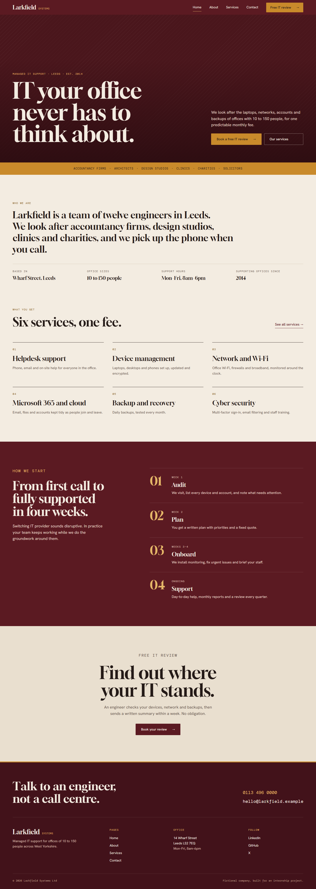

# Larkfield Systems — Responsive Company Website

Week 2, Task 1 of a Full Stack Development internship: a responsive, four-page company website built with plain HTML, CSS and JavaScript.

> **Note:** Larkfield Systems is a fictional company invented for this project. The people, address, phone number and email address are not real. The phone number is in a range Ofcom reserves for fiction, the email uses the reserved `.example` domain, and the social links point to each platform's home page.

## Overview

The site presents a managed IT support provider for small and mid-sized offices. It has four connected pages (Home, About, Services, Contact), a shared header and footer, an animated mobile menu and a contact form with client-side validation.

There is no framework, no build step and no JavaScript dependency. The whole site is static files that can be opened directly in a browser or hosted on any static host.

## Features

- Responsive layout for mobile, tablet and desktop, built with CSS Grid and Flexbox
- Navigation bar with an active-page state and a call-to-action button, which collapses into a JavaScript-driven menu panel below 768px
- Home page with hero, company introduction, six numbered features, a four-step onboarding process and a call-to-action
- About page with company story, timeline, working principles and team section
- Services page with a responsive grid of six service cards, plan inclusions and common questions
- Contact page with contact details and a validated enquiry form
- Consistent footer on every page with company information, navigation, social links and copyright
- Semantic HTML and accessibility basics: skip link, labelled form fields, visible focus styles, keyboard-operable menu and form, `aria-current` on the active page, AA text contrast
- One stylesheet (about 30 KB) and two small scripts (about 6 KB together), with no images other than the favicon

## Pages

| Page | File | Contents |
| --- | --- | --- |
| Home | `index.html` | Hero, sectors served, introduction, features, how we start, call-to-action |
| About | `about.html` | Story and timeline, how we work, team, call-to-action |
| Services | `services.html` | Six service cards, what every plan includes, common questions, call-to-action |
| Contact | `contact.html` | Contact information, enquiry form |

## Technologies

- HTML5
- CSS3 (custom properties, Grid, Flexbox, `clamp()`)
- JavaScript ES6+ (no libraries)
- Google Fonts: [Gloock](https://fonts.google.com/specimen/Gloock), [Hanken Grotesk](https://fonts.google.com/specimen/Hanken+Grotesk) and [DM Mono](https://fonts.google.com/specimen/DM+Mono)
- Git and GitHub for version control

## Responsive Design

The CSS is written mobile-first. Small screens get a single column, and columns are added as space allows.

| Width | What changes |
| --- | --- |
| Below 640px | Single column throughout, menu button, two-column team grid |
| 640px and up | Service cards become two columns |
| 768px and up | Full navigation bar replaces the menu button, team grid and footer become four columns |
| 896px and up | Contact details sit beside the form |
| 960px and up | Heading-and-content sections become two columns |
| 1200px and up | Service cards become three columns |

Several grids (features, timeline, plan inclusions, form fields) use `repeat(auto-fit, minmax(...))`, so they reflow by available width with no breakpoint at all. Headings and section spacing scale with `clamp()`.

The pages were checked at 320, 375, 425, 600, 768, 900, 1024, 1280, 1440 and 1920 pixels wide for horizontal scrolling, elements outside the viewport and clipped text.

## Form Validation

Validation lives in `js/contact-form.js`. Each field is checked when focus leaves it and again when the form is submitted. A field that has been flagged clears its error as soon as the value is corrected.

| Field | Rule |
| --- | --- |
| Full name | Required, at least 2 characters, must contain a letter |
| Work email | Required, must look like `name@company.com` |
| Phone | Optional. If filled in, 7 to 15 digits (spaces, `+`, `-`, `.` and brackets allowed) |
| Company | Optional |
| Topic | Required, one option must be chosen |
| Message | Required, at least 20 characters, at most 1000 |
| Consent | Checkbox must be ticked |

Values are trimmed first, so a field containing only spaces counts as empty.

When a submission is invalid:

- the form is not submitted
- each invalid field shows its own message and is marked with `aria-invalid`
- a summary above the form states how many fields need attention
- keyboard focus moves to the first invalid field

When a submission is valid, a confirmation appears above the form and the form is cleared. The site has no backend, so no data is sent anywhere, and the confirmation says so.

The inputs also carry the native `required` and `type` attributes, so the browser's built-in validation still applies if JavaScript is unavailable.

## Project Structure

```
task-1-company-website/
├── index.html            Home page
├── about.html            About page
├── services.html         Services page
├── contact.html          Contact page
├── css/
│   └── style.css         All styles: design tokens, layout, components
├── js/
│   ├── nav.js            Mobile menu (loaded on every page)
│   └── contact-form.js   Form validation (loaded on the contact page only)
├── assets/
│   └── images/
│       └── favicon.svg   Site icon
├── screenshots/          Page screenshots at three screen sizes
├── .gitignore
└── README.md
```

## How to Run

No installation is needed.

1. Download or clone the repository.
2. Open `index.html` in a browser.

To serve it over a local web server instead, run one of these from the project folder and open the address it prints:

```
python -m http.server 8000
```

```
npx serve
```

## Live Demo

**Live URL:** https://larkfield-systems.vercel.app

The site is hosted on Vercel. It is static, so it deploys as-is with no build command, and would work the same on GitHub Pages or Netlify. `index.html` is at the project root and all links are relative.

## Screenshots

Full-page captures at 375px (mobile), 768px (tablet) and 1440px (desktop).

| Page | Mobile | Tablet | Desktop |
| --- | --- | --- | --- |
| Home | [home-mobile.png](screenshots/home-mobile.png) | [home-tablet.png](screenshots/home-tablet.png) | [home-desktop.png](screenshots/home-desktop.png) |
| About | [about-mobile.png](screenshots/about-mobile.png) | [about-tablet.png](screenshots/about-tablet.png) | [about-desktop.png](screenshots/about-desktop.png) |
| Services | [services-mobile.png](screenshots/services-mobile.png) | [services-tablet.png](screenshots/services-tablet.png) | [services-desktop.png](screenshots/services-desktop.png) |
| Contact | [contact-mobile.png](screenshots/contact-mobile.png) | [contact-tablet.png](screenshots/contact-tablet.png) | [contact-desktop.png](screenshots/contact-desktop.png) |

### Home, desktop



## Design Decisions

**Typography.** Three typefaces, each with one job. Gloock, a high-contrast serif, is used for headings and gives the site most of its character. Hanken Grotesk is used for body text and buttons. DM Mono is used for small uppercase labels, numbering and contact details. Large type is kept for page titles and section headings, and body text stays at 16px.

**Colour.** The palette is burgundy, cream and amber, defined once as CSS custom properties. Burgundy is the brand colour and is used for the header, hero, footer and primary buttons. Cream is the page background, with a slightly darker sand for cards. Amber is the accent, used for the main call-to-action and small highlights. Error and success states have their own red and green. All text combinations were measured against WCAG AA contrast.

**Layout.** Pages alternate between cream and burgundy bands so each section reads as a separate block. Section backgrounds run the full width of the browser, and content sits inside them with fluid side padding that grows from 20px on phones to 80px on large screens. Content only stops widening above 1920px. Corners are almost square (2px), and sections are separated by thin rules and solid colour instead of shadows. Services and steps are numbered instead of given icons, which keeps the look typographic and avoids loading an icon library.

**Imagery.** The site uses no photographs, because a fictional company has no real ones and stock photos would be misleading. The hero uses a fine diagonal hatch for texture, and team members are shown as initials in an arched frame. The arch is sized for portraits, so a real photo can replace the initials later without changing the layout.

**Responsive approach.** Styles are mobile-first, with `min-width` media queries adding columns as the screen widens. Grid handles page-level and card layouts, and Flexbox handles one-dimensional rows such as the header, hero and button groups.

**Navigation.** On screens narrower than 768px the links move into a panel opened by a button labelled "Menu", which changes to "Close" when open. The button is a real `<button>` with `aria-expanded` and `aria-controls`. The panel animates open and closed, and its links are removed from the tab order while it is closed. It also closes when a link is chosen, when Escape is pressed, when the user clicks outside it, or when the window is widened. If JavaScript fails to load, the links stay visible.

**Motion.** Animation is limited to hover transitions, the menu panel and the plus icon on the questions. All of it is switched off for users who set `prefers-reduced-motion`.

**Content.** The copy describes one specific, plausible business instead of generic marketing text. There are no testimonials, client logos or headline statistics, since any of those would have to be made up.
