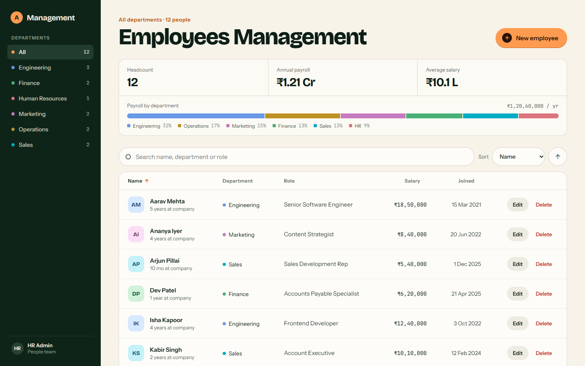
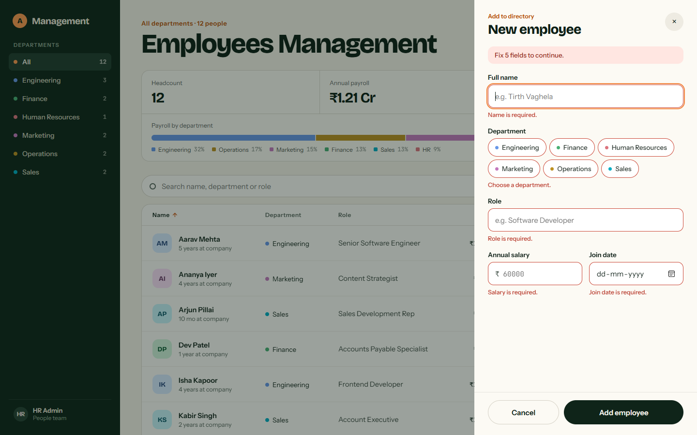
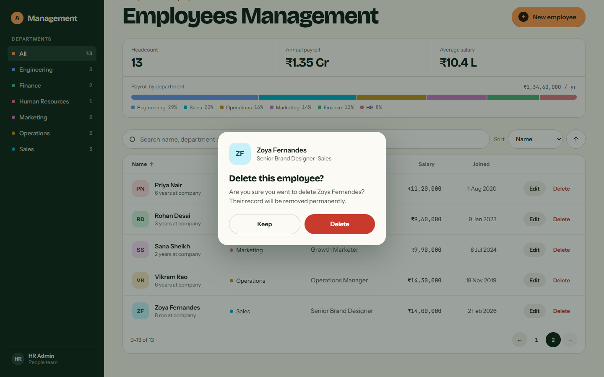
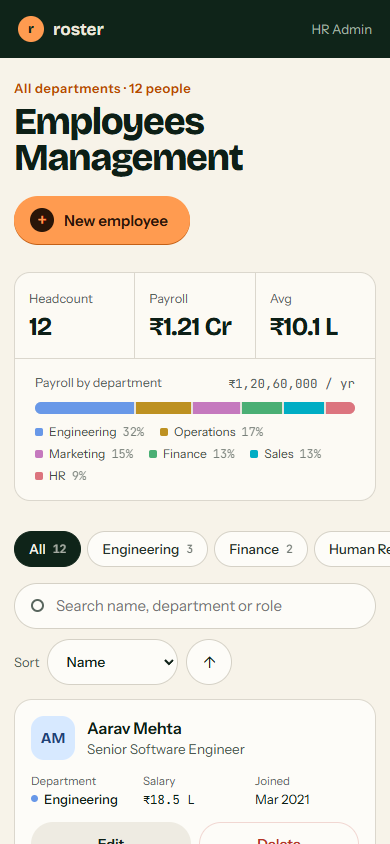
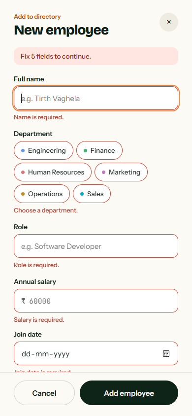

# Employee Management System

Week 2, Task 2 of a Full Stack Development internship: a full-stack CRUD application that lets an HR administrator manage employee records.

The React frontend talks to a Flask REST API, and the API stores the records in MongoDB.

**Live demo:** https://employee-management-app-theta-ivory.vercel.app



## 1. Project overview

An HR administrator can view all employees in a directory, filter them by department, search and sort them, add a new employee, edit an existing one, and delete one after confirming. A summary panel shows headcount, annual payroll, average salary and how payroll is split between departments. Every change goes through the REST API and is saved in MongoDB, so the data is still there after a page refresh or a server restart.

Each employee record has an id, name, department, role, salary and join date.

## 2. Features

- **Create:** add an employee through a validated form.
- **Read:** the employee table is loaded from MongoDB through the API.
- **Update:** edit an employee in the same drawer form, pre-filled with the current values.
- **Delete:** remove an employee, but only after a confirmation dialog.
- **Search** by name, department or role, and **filter** by department from the sidebar, which shows a count for each department.
- **Sort** by name, department, role, salary or join date, in either direction, from the table headers or the sort control. The active column shows an arrow for the direction.
- **Pagination:** 8 employees per page in the table view and 5 in the card view.
- **Summary panel:** headcount, annual payroll, average salary and a payroll-by-department bar, all calculated from the loaded records.
- **Validation** in the browser for quick feedback and again in the API, which is the check that protects the data.
- **Loading states:** a placeholder while the list loads, and "Saving…" / "Deleting…" buttons that cannot be pressed twice.
- **Error states:** clear messages when the server or database is unavailable, with a "Try again" button. No technical error text is shown to the user.
- **Success notifications** after adding, updating and deleting.
- **Responsive layout:** a sidebar and table on wide screens, a sidebar and cards on laptops and tablets in landscape, and a top bar with department chips and cards on phones. See [Responsive design](#responsive-design).
- **Accessible:** real buttons and labels, keyboard-operable dialogs that trap and return focus, and announcements for screen readers.

## 3. Tech stack

| Layer | Technology |
| --- | --- |
| Frontend | React 19, JavaScript, plain CSS, Vite |
| Backend | Python, Flask 3, Flask-Cors |
| Database | MongoDB, accessed with PyMongo |
| API | REST over HTTP with JSON (GET, POST, PUT, DELETE) |
| API testing | Postman collection, plus pytest for automated tests |

The frontend uses no UI library and no HTTP library; it uses the browser's `fetch`.

## 4. Project structure

```
task-2-employee-management/
├── backend/
│   ├── app.py                     Flask app factory, CORS, JSON error handlers
│   ├── config.py                  Settings read from environment variables
│   ├── errors.py                  ValidationError and NotFoundError
│   ├── seed.py                    Optional sample data
│   ├── routes/
│   │   └── employee_routes.py     The four REST endpoints
│   ├── services/
│   │   └── employee_service.py    Business logic and MongoDB queries
│   ├── models/
│   │   └── employee.py            Field validation and JSON conversion
│   ├── database/
│   │   └── mongo.py               MongoDB connection
│   ├── tests/
│   │   └── test_api.py            Automated API tests
│   ├── requirements.txt
│   ├── requirements-dev.txt       Adds pytest
│   └── .env.example
├── frontend/
│   ├── index.html
│   ├── vite.config.js
│   ├── package.json
│   ├── .env.example
│   └── src/
│       ├── main.jsx
│       ├── App.jsx
│       ├── styles.css
│       ├── constants.js           Departments and their colours, columns, page sizes
│       ├── pages/
│       │   └── EmployeeDashboard.jsx   Page state, filtering, sorting and CRUD handlers
│       ├── components/
│       │   ├── Sidebar.jsx        Department navigation (sidebar and mobile chips)
│       │   ├── StatsPanel.jsx     Headcount, payroll and payroll-by-department bar
│       │   ├── SearchBar.jsx      Search box and sort controls
│       │   ├── EmployeeTable.jsx  Table, mobile cards, pager, and the loading, empty and error states
│       │   ├── EmployeeForm.jsx   Add and edit drawer
│       │   ├── DeleteModal.jsx    Delete confirmation
│       │   ├── Toast.jsx          Notifications
│       │   └── Modal.jsx          Shared dialog shell
│       ├── hooks/
│       │   └── useMediaQuery.js   Switches between the desktop and mobile layouts
│       ├── services/
│       │   └── employeeApi.js     Every API call
│       └── utils/
│           ├── validation.js      Form validation rules
│           └── format.js          Salary, date, tenure and department colour helpers
├── postman/
│   └── Employee-Management-API.postman_collection.json
├── docs/
│   └── database-schema.md
├── screenshots/
├── vercel.json                    Deployment routing for Vercel
├── .gitignore
└── README.md
```

The frontend and backend are separate applications. React never connects to MongoDB; it only calls the API.

## Prerequisites

Install these before setting the project up:

| Tool | Version | Used for |
| --- | --- | --- |
| [Python](https://www.python.org/downloads/) | 3.10 or newer | The Flask backend |
| [Node.js](https://nodejs.org/) | 20 or newer (includes npm) | The React frontend |
| [MongoDB](https://www.mongodb.com/try/download/community) | 6 or newer, local or an Atlas cluster | The database |
| [Postman](https://www.postman.com/downloads/) | Any recent version | Optional, for trying the API by hand |

The project was built and tested with Python 3.12, Node.js 22 and MongoDB 8.2 on Windows 11.

## 5. MongoDB setup

Use either a local MongoDB or MongoDB Atlas.

**Local MongoDB**

1. Install [MongoDB Community Server](https://www.mongodb.com/try/download/community).
2. Make sure it is running. On Windows it runs as a service called "MongoDB".
3. The default connection string `mongodb://localhost:27017` then works with no further setup.

**MongoDB Atlas**

1. Create a free cluster at [mongodb.com/atlas](https://www.mongodb.com/atlas).
2. Create a database user and allow your IP address under Network Access.
3. Copy the connection string (it starts with `mongodb+srv://`) into `MONGO_URI` in `backend/.env`.

You do not need to create the database or the collection. MongoDB creates `employee_management` and `employees` when the first employee is saved.

## 6. Backend setup

Run these from the `backend` folder.

```powershell
cd backend

# Create and activate a virtual environment
python -m venv venv
venv\Scripts\activate

# Install Python dependencies
pip install -r requirements.txt

# Create your local settings file
copy .env.example .env
```

On macOS or Linux, activate with `source venv/bin/activate` and copy with `cp .env.example .env`.

Optionally load twelve sample employees:

```powershell
python seed.py
```

`python seed.py` does nothing if the collection already has data. `python seed.py --reset` deletes every employee first and then adds the samples.

## 7. Frontend setup

Run these from the `frontend` folder.

```powershell
cd frontend

# Install frontend dependencies
npm install
```

The frontend expects the API at `http://localhost:5000/api`. If yours is somewhere else, copy `.env.example` to `.env` and change `VITE_API_URL`.

## 8. Environment variables

No secret is stored in the code. Real `.env` files are listed in `.gitignore` and must not be committed; only the `.env.example` files are.

**Backend (`backend/.env`)**

| Variable | Default | Purpose |
| --- | --- | --- |
| `MONGO_URI` | `mongodb://localhost:27017` | MongoDB connection string. For Atlas this contains your username and password. |
| `MONGO_DB_NAME` | `employee_management` | Database that holds the `employees` collection. |
| `MONGO_TIMEOUT_MS` | `3000` | How long to wait for MongoDB before reporting it as unavailable. |
| `CORS_ORIGINS` | `http://localhost:5173,http://127.0.0.1:5173` | Comma-separated frontend addresses allowed to call the API. |
| `FLASK_HOST` | `127.0.0.1` | Address the API listens on. |
| `FLASK_PORT` | `5000` | Port the API listens on. |
| `FLASK_DEBUG` | `0` (`1` in `.env.example`) | Set to `1` for auto-reload during development. |

**Frontend (`frontend/.env`)**

| Variable | Default | Purpose |
| --- | --- | --- |
| `VITE_API_URL` | `http://localhost:5000/api` | Base URL of the Flask API. |

CORS is limited to the addresses in `CORS_ORIGINS`; it is not open to every website. If you change the frontend's port or deploy it, add the new address there.

## 9. How to run the application

Start MongoDB, then use two terminals.

**Terminal 1: start Flask**

```powershell
cd backend
venv\Scripts\activate
python app.py
```

The API runs at `http://127.0.0.1:5000`.

**Terminal 2: start React**

```powershell
cd frontend
npm run dev
```

Open `http://localhost:5173` in a browser.

**Run the backend tests** (optional; they use a separate `employee_management_test` database):

```powershell
cd backend
pip install -r requirements-dev.txt
python -m pytest
```

**Build the frontend for production** (optional):

```powershell
cd frontend
npm run build
```

## 10. REST API endpoints

Base URL: `http://localhost:5000`

| Method | Endpoint | Purpose | Success | Errors |
| --- | --- | --- | --- | --- |
| GET | `/api/employees` | List employees | 200 | 400 for an unknown `sort` or `order` |
| POST | `/api/employees` | Add an employee | 201 | 400 for invalid data |
| PUT | `/api/employees/<id>` | Update an employee | 200 | 400 for invalid data or a malformed id, 404 if not found |
| DELETE | `/api/employees/<id>` | Delete an employee | 200 | 400 for a malformed id, 404 if not found |

Any endpoint returns 503 if MongoDB cannot be reached and 500 for an unexpected server error.

**Optional query parameters for GET**

| Parameter | Values | Default |
| --- | --- | --- |
| `search` | Text matched against name, department and role, ignoring case | none |
| `department` | Exact department name | none |
| `sort` | `name`, `department`, `role`, `salary`, `joinDate` | `name` |
| `order` | `asc`, `desc` | `asc` |

Example: `GET /api/employees?search=engineer&sort=salary&order=desc`

**Request body for POST and PUT** (all five fields are required)

```json
{
  "name": "Tirth Vaghela",
  "department": "Engineering",
  "role": "Software Developer",
  "salary": 60000,
  "joinDate": "2026-06-12"
}
```

**Response format**

Every response is JSON with a `success` flag.

Success (POST shown):

```json
{
  "success": true,
  "message": "Employee added successfully.",
  "data": {
    "id": "6ac39e2ebdac8018066b53c6",
    "name": "Tirth Vaghela",
    "department": "Engineering",
    "role": "Software Developer",
    "salary": 60000,
    "joinDate": "2026-06-12"
  }
}
```

GET returns `data` as an array, plus a `count`.

Error:

```json
{
  "success": false,
  "message": "Employee not found."
}
```

Validation errors also include an `errors` object with one message per invalid field:

```json
{
  "success": false,
  "message": "Validation failed.",
  "errors": {
    "salary": "Salary must be greater than 0.",
    "joinDate": "Join date must be a valid date in YYYY-MM-DD format."
  }
}
```

**Validation rules**

| Field | Rule |
| --- | --- |
| `name` | Text, 2 to 80 characters, must contain a letter |
| `department` | Text, 2 to 50 characters, must contain a letter |
| `role` | Text, 2 to 80 characters, must contain a letter |
| `salary` | A JSON number greater than 0 and at most 100,000,000 |
| `joinDate` | A real date as `YYYY-MM-DD`, from 1970-01-01 up to one year from today |

## 11. Postman collection

The collection is at [`postman/Employee-Management-API.postman_collection.json`](postman/Employee-Management-API.postman_collection.json).

1. In Postman, choose **Import** and select the file.
2. Start the Flask API.
3. Run the requests in order, or use **Run collection**.

| Folder | Request | Expected |
| --- | --- | --- |
| Employees (CRUD) | Get all employees | 200 |
| | Add employee | 201 |
| | Update employee | 200 |
| | Get employees after update (search) | 200 |
| | Delete employee | 200 |
| Error cases | Add employee with invalid data | 400 |
| | Update employee that does not exist | 404 |
| | Delete with a malformed id | 400 |

"Add employee" saves the new id in the collection variable `employeeId`, and the update and delete requests use it, so no id has to be copied by hand. Each request has test scripts that check the status code and the response body. Change the `baseUrl` collection variable if your API is not on `http://localhost:5000`.

## 12. Database structure

Database `employee_management`, collection `employees`, one document per employee.

| Field | Type | Required | Purpose |
| --- | --- | --- | --- |
| `_id` | ObjectId | Generated by MongoDB | Unique identifier, returned by the API as the string `id` |
| `name` | String | Yes | Full name |
| `department` | String | Yes | Department |
| `role` | String | Yes | Job title |
| `salary` | Number | Yes | Annual salary |
| `joinDate` | String (`YYYY-MM-DD`) | Yes | Date the employee joined |

The full schema, an example document and the reasons behind the type choices are in [`docs/database-schema.md`](docs/database-schema.md).

## 13. CRUD workflow

Each operation follows the same path: a React component calls a function in `services/employeeApi.js`, which sends an HTTP request to Flask. The route passes the request to the service layer, which validates the data and reads or writes MongoDB. The JSON response then updates the screen.

**Create**

1. The user clicks "New employee" and fills in the drawer form.
2. The form validates the fields in the browser.
3. React sends `POST /api/employees`.
4. Flask validates again and inserts the document into MongoDB.
5. The API returns 201 with the new employee.
6. The drawer closes, "Employee added successfully." appears, and the list is re-read from the API.

**Read**

1. The dashboard sends `GET /api/employees`.
2. Flask queries MongoDB and returns every employee as JSON.
3. React renders them in the table and calculates the summary panel and department counts from the same data.
4. Search, department filter, sorting and paging are then applied in the browser, so they respond instantly. The API also supports `search`, `department`, `sort` and `order` itself (see section 10), which the Postman collection demonstrates.

**Update**

1. The user clicks "Edit" and the drawer opens with that employee's values.
2. React sends `PUT /api/employees/<id>`.
3. Flask validates and updates the document.
4. The drawer closes, "Employee updated successfully." appears, and the list is re-read from the API.

**Delete**

1. The user clicks "Delete" and a confirmation dialog asks "Are you sure you want to delete [name]? Their record will be removed permanently."
2. Nothing is sent unless the user presses "Delete". "Keep" closes the dialog.
3. React sends `DELETE /api/employees/<id>`.
4. Flask removes the document.
5. The dialog closes, the row disappears and "Employee deleted successfully." appears.

## Deployment

The live demo runs on [Vercel](https://vercel.com), with the data in a free [MongoDB Atlas](https://www.mongodb.com/atlas) cluster.

| Part | Where it runs |
| --- | --- |
| React frontend | Vercel, built with Vite and served as static files |
| Flask backend | Vercel, as a Python function |
| MongoDB | MongoDB Atlas |

Both parts are deployed together as one Vercel project, so they share one address. `vercel.json` sends every request under `/api/` to the Flask backend and everything else to the React frontend. Because the frontend and the API are on the same address, no CORS setting is needed in production.

The project has three environment variables on Vercel:

| Variable | Value |
| --- | --- |
| `MONGO_URI` | The Atlas connection string, stored as a secret |
| `MONGO_DB_NAME` | `employee_management` |
| `VITE_API_URL` | `/api` |

To deploy your own copy, create an Atlas cluster that allows access from anywhere (`0.0.0.0/0`), then run these from this folder:

```powershell
vercel
vercel env add MONGO_URI production
vercel env add MONGO_DB_NAME production
vercel env add VITE_API_URL production
vercel --prod
```

The first request after a quiet period can take a few seconds, because the backend starts on demand.

## Responsive design

The layout changes at two widths, so the employee list always fits the screen without scrolling sideways.

| Screen width | Navigation | Employee list | Per page |
| --- | --- | --- | --- |
| Below 820px (phones, tablets in portrait) | Top bar, with departments as a scrolling row of chips | Cards | 5 |
| 820px to 1279px (tablets in landscape, small laptops) | Sidebar | Cards | 5 |
| 1280px and wider (laptops, desktops) | Sidebar | Table | 8 |

The table needs about 900px to show every column and both action buttons, which is not available beside the sidebar on narrower screens. Cards are used there so that "Edit" and "Delete" are always visible.

Other details:

- The content area fills the space beside the sidebar at every width; there is no fixed maximum.
- The add and edit drawer is 460px wide and becomes full width on phones. Its "Cancel" and submit buttons stay pinned to the bottom.
- The delete confirmation stays centred and shrinks to fit narrow screens.
- On phones, salaries and dates use short forms (`₹18.5 L`, `Mar 2021`) and the stat labels are shortened.
- Buttons in the card view are 44px tall for touch.

The layout was checked at 16 widths from 320px to 1920px for sideways scrolling, off-screen content and clipped text, with the drawer and the delete dialog opened at each one.

## Screenshots

| Add employee drawer with validation | Delete confirmation |
| --- | --- |
|  |  |

| Dashboard on a phone | Add employee on a phone |
| --- | --- |
|  |  |

## Testing

- **Backend:** 56 pytest tests cover the four endpoints, every validation rule, search, filtering, sorting, the 400/404/503/500 responses and CORS, against a real MongoDB test database.
- **Postman:** the collection's 8 requests and 16 assertions pass.
- **Full stack:** the complete flow was exercised in a real browser against the running Flask and MongoDB: create, read, update and delete (each confirmed in the database), search, department filter, sorting, pagination, the summary figures, validation, loading and error states, and layout from 320px to 1920px wide (see [Responsive design](#responsive-design)).

## Known limitations

- **No sign-in.** Task 2 does not require authentication, so anyone who can reach the API can read and change the data. That includes the live demo: its data is public and anyone can edit it.
- **The whole list is loaded at once.** Search, filtering, sorting and paging happen in the browser, which is fast for hundreds of employees but would need server-side paging for many thousands. The API already supports `search`, `department`, `sort` and `order`.
- **No protection against simultaneous edits.** If two people edit the same employee, the last save wins. Editing or deleting a record that someone else has already deleted shows "Employee not found." and refreshes the list.
- **One currency.** Salaries are stored as plain numbers and always displayed in Indian rupees.

## Notes

- Salaries are displayed in Indian rupees, with lakh (L) and crore (Cr) for the short forms. The formatting lives in `frontend/src/utils/format.js`.
- The sidebar and form offer six standard departments, listed with their colours in `frontend/src/constants.js`. The API accepts any department name, and one outside the list still appears in the sidebar and form.
- The interface follows the supplied design: forest green, cream and amber, set in Bricolage Grotesque, Instrument Sans and JetBrains Mono.
- The sample employees in `seed.py` are invented.
