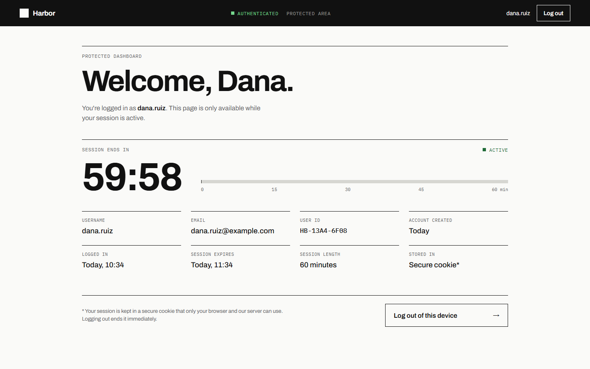
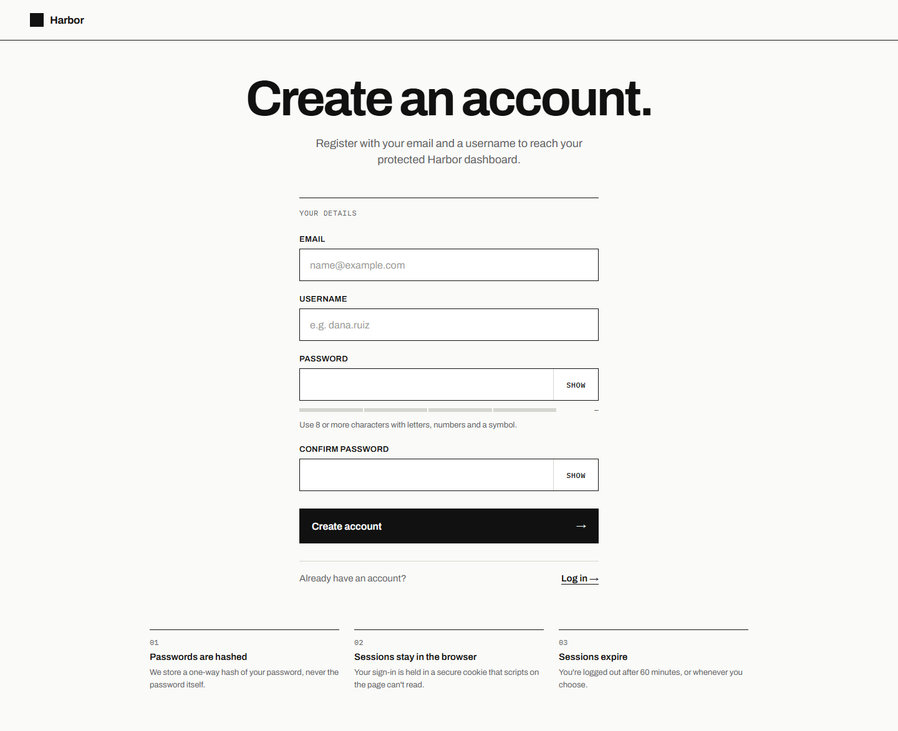
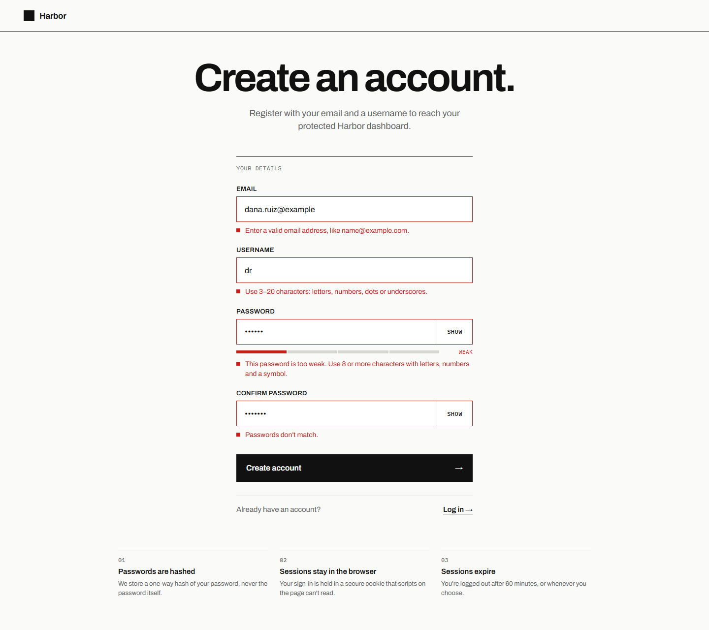
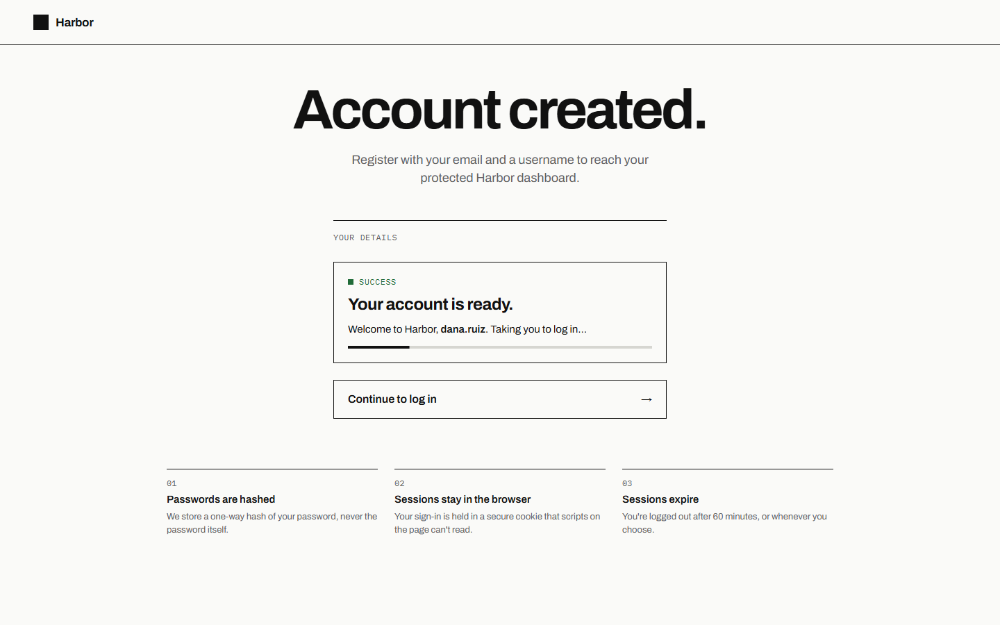
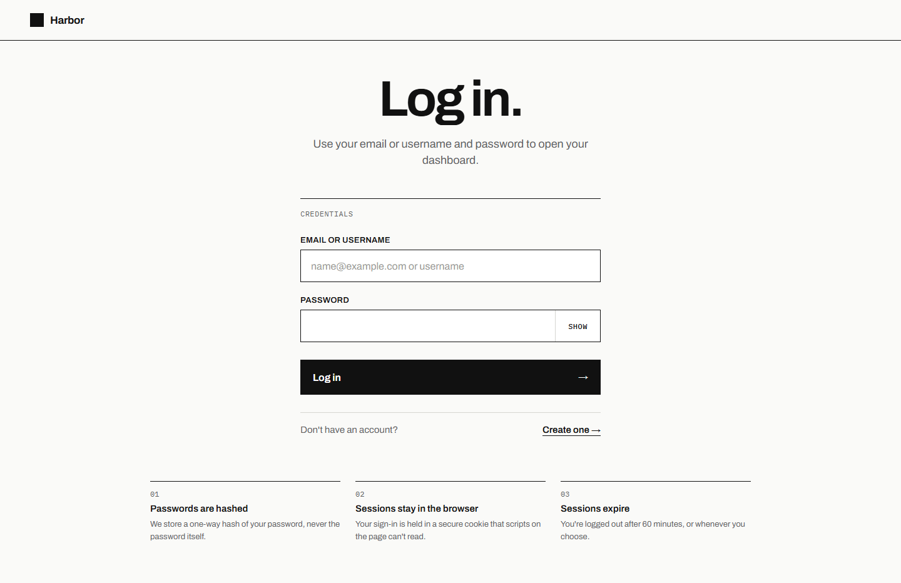
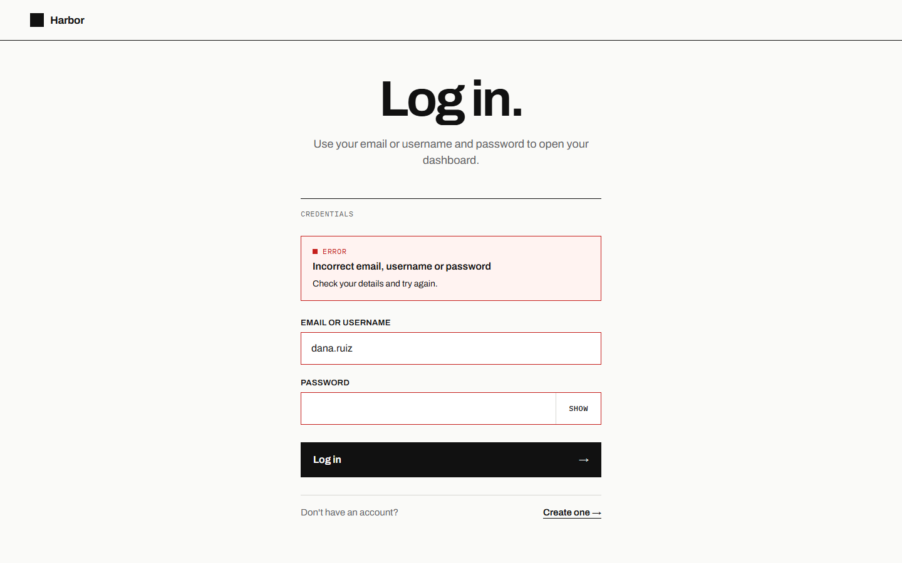
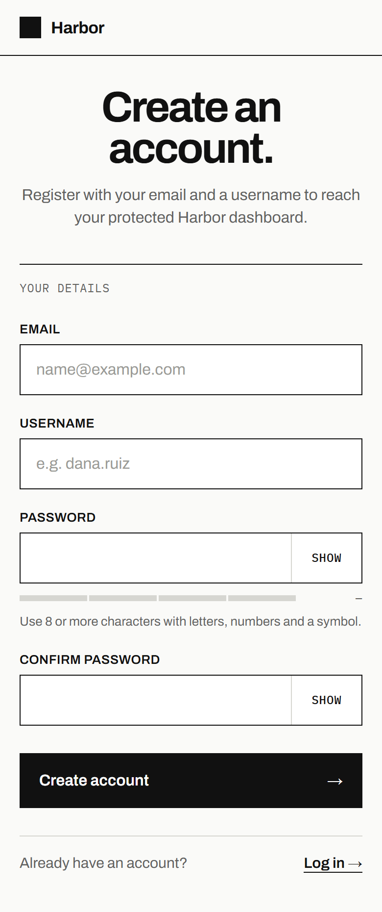
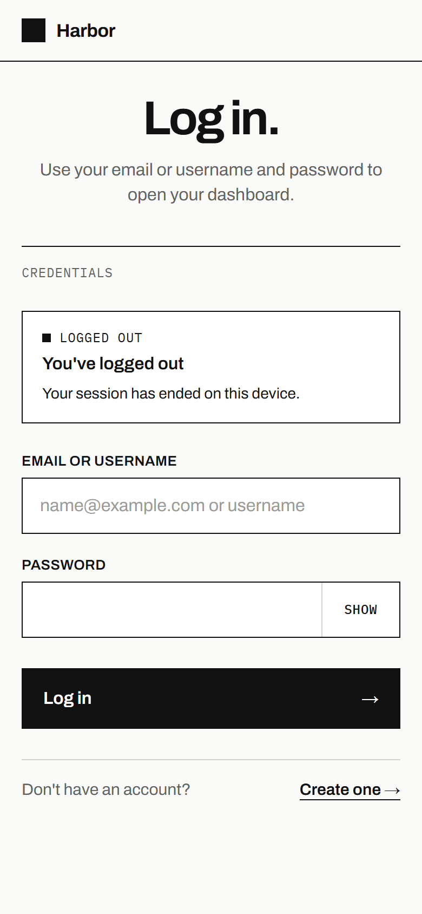
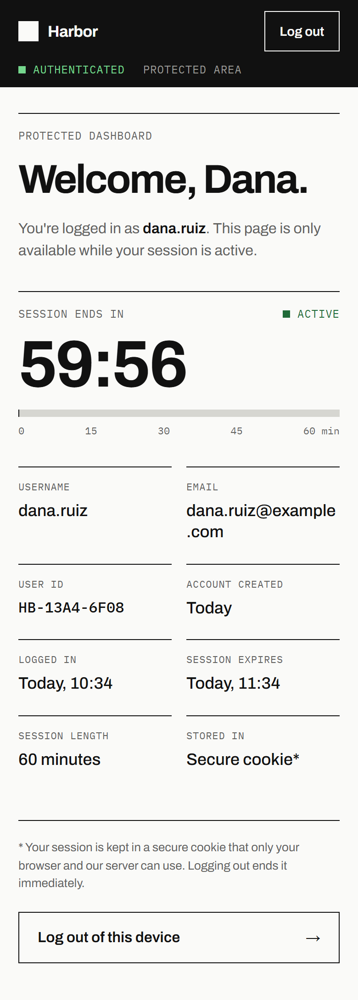

# Authentication System

Week 2, Task 3 of a Full Stack Development internship: a secure registration and login system with a protected dashboard.

The React frontend talks to a Flask REST API. Accounts are stored in MongoDB with bcrypt-hashed passwords, and a login is held in a JWT inside an HttpOnly cookie.



## Overview

A visitor can create an account, log in with their email or username, open a dashboard that only logged-in users can reach, and log out.

The interface is called "Harbor" and has three screens:

| Screen | Address | Who can open it |
| --- | --- | --- |
| Register | `/register` | Anyone |
| Log in | `/login` | Anyone |
| Dashboard | `/dashboard` | Logged-in users only |

Opening `/dashboard` without a valid login shows a short "Checking your session" screen and then returns the visitor to the login page.

## Features

- **Registration** with email, username, password and password confirmation
- **Login** with either the email address or the username
- **Password hashing** with bcrypt; the plain password is never stored
- **JWT authentication**, with the token kept in an HttpOnly cookie
- **Protected dashboard** that the server refuses to serve without a valid token
- **Logout** that deletes the cookie and cancels the token on the server
- **Session expiry** after 60 minutes, with a live countdown and a warning in the last five minutes
- **Input validation** in the browser and again on the server, with sanitization of every value
- **Duplicate protection** for both email and username
- **Clear messages** for every outcome: invalid input, wrong credentials, duplicate account, expired session, logged out, server unavailable
- **Password strength meter** and Show/Hide buttons on password fields
- **Responsive layout** for desktop, tablet and mobile

## Technology Stack

| Layer | Technology |
| --- | --- |
| Frontend | React 19, Vite, React Router, JavaScript, plain CSS |
| Backend | Python, Flask 3, Flask-Cors |
| Database | MongoDB, accessed with PyMongo |
| Password hashing | bcrypt |
| Sessions | JSON Web Tokens (PyJWT), stored in an HttpOnly cookie |
| Tests | pytest |

No UI library and no HTTP library are used; the frontend calls the API with the browser's `fetch`.

## Project Structure

```
task-3-authentication-system/
├── backend/
│   ├── app.py                   Flask app factory, CORS, JSON error handlers
│   ├── config.py                Settings read from environment variables
│   ├── errors.py                Error types the API can return
│   ├── auth/                    The authentication module
│   │   ├── routes.py            /api/register, /api/login, /api/logout
│   │   ├── service.py           Register, check credentials, cancel tokens
│   │   ├── security.py          bcrypt hashing, JWT create/verify, cookie settings
│   │   ├── middleware.py        login_required: protects a route
│   │   └── validation.py        Input rules and sanitization
│   ├── models/
│   │   └── user.py              User document and its JSON form
│   ├── database/
│   │   └── mongo.py             MongoDB connection and indexes
│   ├── routes/
│   │   └── dashboard_routes.py  /api/dashboard (protected)
│   ├── tests/
│   │   └── test_auth.py         Automated API tests
│   ├── requirements.txt
│   ├── requirements-dev.txt     Adds pytest
│   └── .env.example
├── frontend/
│   ├── index.html
│   ├── vite.config.js           Dev server and the /api proxy
│   ├── package.json
│   ├── .env.example
│   └── src/
│       ├── main.jsx
│       ├── App.jsx              The three routes
│       ├── styles.css
│       ├── pages/
│       │   ├── RegisterPage.jsx
│       │   ├── LoginPage.jsx
│       │   └── DashboardPage.jsx
│       ├── components/
│       │   ├── ProtectedRoute.jsx   Asks the server whether the user is logged in
│       │   ├── PublicLayout.jsx     Shared frame for Register and Log in
│       │   ├── Field.jsx            Input with error, Show/Hide and strength meter
│       │   ├── SubmitButton.jsx
│       │   ├── Banner.jsx
│       │   ├── Brand.jsx
│       │   └── Spinner.jsx
│       ├── services/
│       │   └── authApi.js           Every API call
│       ├── content/
│       │   └── banners.js           Banner messages
│       └── utils/
│           ├── validation.js        Form rules and password strength
│           └── format.js            Time, date and name formatting
├── screenshots/
├── .gitignore
└── README.md
```

Everything to do with authentication is in `backend/auth/`. Each file there has one job, so the flow can be followed in order: `routes.py` receives the request, `validation.py` checks the input, `service.py` does the work, `security.py` handles hashing and tokens, and `middleware.py` guards protected routes.

## Installation

### Prerequisites

| Tool | Version |
| --- | --- |
| [Python](https://www.python.org/downloads/) | 3.10 or newer |
| [Node.js](https://nodejs.org/) | 20 or newer (includes npm) |
| [MongoDB](https://www.mongodb.com/try/download/community) | 6 or newer, local or an Atlas cluster |

### MongoDB setup

Install MongoDB Community Server and make sure it is running. On Windows it runs as a service called "MongoDB". The default connection string `mongodb://localhost:27017` then works with no further setup.

You do not need to create anything by hand. On first start the backend creates the `authentication_system` database, the `users` collection and its indexes.

To use MongoDB Atlas instead, put its `mongodb+srv://` connection string in `MONGO_URI` in `backend/.env`.

### Backend installation and startup

Run these from the `backend` folder.

```powershell
cd backend

# Create and activate a virtual environment
python -m venv venv
venv\Scripts\activate

# Install Python dependencies
pip install -r requirements.txt

# Create your local settings file
copy .env.example .env
```

On macOS or Linux, activate with `source venv/bin/activate` and copy with `cp .env.example .env`.

Open `backend/.env` and set `JWT_SECRET` to a long random value. Generate one with:

```powershell
python -c "import secrets; print(secrets.token_hex(32))"
```

Start the API:

```powershell
python app.py
```

It runs at `http://127.0.0.1:5001`.

### Frontend installation and startup

In a second terminal, run these from the `frontend` folder.

```powershell
cd frontend
npm install
npm run dev
```

Open `http://localhost:5175` in a browser.

The dev server forwards every request under `/api` to the Flask API on port 5001, so the browser sees the page and the API on one address.

## Environment Variables

No secret is written in the code. Real `.env` files are listed in `.gitignore` and must never be committed; only the `.env.example` files, which contain placeholders, are.

**Backend (`backend/.env`)**

| Variable | Default | Purpose |
| --- | --- | --- |
| `JWT_SECRET` | none | Key used to sign login tokens. Anyone who knows it can forge a login, so keep it private and random. |
| `JWT_EXPIRES_MINUTES` | `60` | How long a login lasts. |
| `MONGO_URI` | `mongodb://localhost:27017` | MongoDB connection string. For Atlas this contains a username and password. |
| `MONGO_DB_NAME` | `authentication_system` | Database that holds the `users` collection. |
| `MONGO_TIMEOUT_MS` | `3000` | How long to wait for MongoDB before reporting it as unavailable. |
| `COOKIE_SECURE` | `0` | Set to `1` to send the login cookie over HTTPS only. Required on any real deployment. |
| `COOKIE_SAMESITE` | `Lax` | Cross-site policy for the login cookie (`Lax` or `Strict`). |
| `BCRYPT_ROUNDS` | `12` | bcrypt work factor. Higher is slower to crack and slower to log in. |
| `CORS_ORIGINS` | `http://localhost:5175,http://127.0.0.1:5175` | Frontend addresses allowed to call the API directly. |
| `FLASK_HOST` | `127.0.0.1` | Address the API listens on. |
| `FLASK_PORT` | `5001` | Port the API listens on. |
| `FLASK_DEBUG` | `0` | Debug mode. Off unless set to `1`. |

If `JWT_SECRET` is missing, or still set to the placeholder from `.env.example`, the server still starts: it creates a temporary random key and logs a warning. Every login then ends when the server restarts, which is safe but inconvenient, so set a real one.

**Frontend (`frontend/.env`, optional)**

| Variable | Default | Purpose |
| --- | --- | --- |
| `VITE_API_PROXY_TARGET` | `http://localhost:5001` | Where the dev server forwards `/api` requests. |
| `VITE_API_URL` | `/api` | Base URL the browser uses for API calls. |

## API Documentation

Base URL: `http://localhost:5001`

Every response is JSON with a `success` flag. Errors have this shape:

```json
{
  "success": false,
  "message": "A short explanation.",
  "errors": { "field": "Message for that field." },
  "code": "machine_readable_reason"
}
```

`errors` appears only for form problems, and `code` only for login and session problems.

| Method | URL | Purpose | Login required |
| --- | --- | --- | --- |
| POST | `/api/register` | Create an account | No |
| POST | `/api/login` | Log in and receive the cookie | No |
| POST | `/api/logout` | End the session | No |
| GET | `/api/dashboard` | The user's details and session | **Yes** |

### POST /api/register

**Purpose:** create a new account. It does not log the user in.

**Authentication:** none.

**Request body:**

```json
{
  "email": "dana.ruiz@example.com",
  "username": "dana.ruiz",
  "password": "Harbor#2026",
  "confirm_password": "Harbor#2026"
}
```

| Field | Rule |
| --- | --- |
| `email` | A valid email address, at most 254 characters. Stored in lower case. |
| `username` | 3 to 20 characters: letters, numbers, dots or underscores. |
| `password` | 8 or more characters, with at least two of: mixed upper and lower case, a number, a symbol. At most 72 characters. |
| `confirm_password` | Must equal `password`. |

**Success: 201 Created**

```json
{
  "success": true,
  "message": "Account created.",
  "data": {
    "user": {
      "id": "6ac3e1f0a1b2c3d4e5f67793",
      "email": "dana.ruiz@example.com",
      "username": "dana.ruiz",
      "created_at": "2026-03-12T09:41:00Z"
    }
  }
}
```

**Errors:**

| Status | When | Example |
| --- | --- | --- |
| 400 | A field is missing or invalid, or the body is not a JSON object | `"errors": { "email": "Enter a valid email address, like name@example.com." }` |
| 409 | The email or username is already registered | `"errors": { "email": "An account with this email already exists. Log in instead." }` |
| 503 | The database cannot be reached | `"message": "The service is temporarily unavailable. Please try again shortly."` |

### POST /api/login

**Purpose:** check the credentials and start a session.

**Authentication:** none.

**Request body:**

```json
{
  "identifier": "dana.ruiz",
  "password": "Harbor#2026"
}
```

`identifier` is the email address or the username. Upper and lower case are treated the same.

**Success: 200 OK**

```json
{
  "success": true,
  "message": "Logged in.",
  "data": {
    "user": {
      "id": "6ac3e1f0a1b2c3d4e5f67793",
      "email": "dana.ruiz@example.com",
      "username": "dana.ruiz",
      "created_at": "2026-03-12T09:41:00Z"
    },
    "session": { "expires_at": "2026-03-12T10:42:00Z" }
  }
}
```

The response also sets the login cookie. The token is not in the JSON body.

```
Set-Cookie: access_token=<JWT>; HttpOnly; SameSite=Lax; Path=/; Max-Age=3600
```

**Errors:**

| Status | When | Body |
| --- | --- | --- |
| 400 | A field is empty, or a value is not text | `"errors": { "identifier": "Enter your email or username.", "password": "Enter your password." }` |
| 401 | Wrong password or unknown account | `"message": "Incorrect email, username or password.", "code": "invalid_credentials"` |
| 503 | The database cannot be reached | As above |

A wrong password and an unknown account return exactly the same response, so the API never reveals which accounts exist.

### POST /api/logout

**Purpose:** end the current session.

**Authentication:** none required. It always succeeds, so a user with an expired session can still log out cleanly.

**Request body:** none.

**Success: 200 OK**

```json
{
  "success": true,
  "message": "Logged out."
}
```

The response deletes the cookie (`Set-Cookie: access_token=; Max-Age=0; ...`). If the request carried a valid token, that token is also cancelled on the server, so a copy of it stops working immediately.

**Errors:** 503 if the database cannot be reached.

### GET /api/dashboard

**Purpose:** return the logged-in user's details and when their session ends. This is the protected route; the dashboard page cannot be shown without it.

**Authentication:** **required.** The request must carry a valid `access_token` cookie.

**Request body:** none.

**Success: 200 OK**

```json
{
  "success": true,
  "data": {
    "user": {
      "id": "6ac3e1f0a1b2c3d4e5f67793",
      "email": "dana.ruiz@example.com",
      "username": "dana.ruiz",
      "created_at": "2026-03-12T09:41:00Z"
    },
    "session": {
      "issued_at": "2026-03-12T09:42:00Z",
      "expires_at": "2026-03-12T10:42:00Z",
      "expires_in": 3587,
      "length_minutes": 60
    }
  }
}
```

`expires_in` is the number of seconds left.

**Errors:**

| Status | When | Body |
| --- | --- | --- |
| 401 | No cookie, an altered or forged token, a token cancelled by logout, or a deleted account | `"message": "Please log in to continue.", "code": "auth_required"` |
| 401 | The token has passed its expiry time | `"message": "Your session has expired. Please log in again.", "code": "session_expired"` |
| 503 | The database cannot be reached | As above |

### Other responses

Unknown addresses return 404 and unsupported methods return 405, both as JSON. An unexpected fault returns 500 with `"An unexpected server error occurred."` and no technical detail.

## Database

Database `authentication_system`, collection `users`, one document per account.

| Field | Type | Purpose |
| --- | --- | --- |
| `_id` | ObjectId | Unique id, created by MongoDB. Returned by the API as the string `id`. |
| `email` | String | Email address, lower case. Unique. |
| `username` | String | Username as the user typed it. Unique, ignoring case. |
| `password_hash` | String | bcrypt hash of the password. |
| `created_at` | Date | When the account was created (UTC). |

Example document:

```json
{
  "_id": { "$oid": "6ac3e1f0a1b2c3d4e5f67793" },
  "email": "dana.ruiz@example.com",
  "username": "dana.ruiz",
  "password_hash": "$2b$12$S5F9yLVI/ZtNrROVMCc3X.YI4ns2eCmyb9JTgRBDWAIrQ1cAox2iW",
  "created_at": { "$date": "2026-03-12T09:41:00Z" }
}
```

Two unique indexes, on `email` and on `username`, make the database itself refuse a duplicate account, even if two registrations arrive at the same moment.

A second small collection, `revoked_tokens`, records the id of each token cancelled by a logout, with the time that token would have expired. MongoDB deletes each record automatically at that time. It holds only a random token id, never a token, a password or any personal detail.

## Security Notes

**Passwords are hashed with bcrypt.** `auth/security.py` hashes every password with bcrypt before it is saved. bcrypt adds a random salt, so two users with the same password have different hashes, and it is deliberately slow (work factor 12), which makes guessing expensive.

**Plaintext passwords are never stored.** The database holds only `password_hash`. The password is not written to logs and never appears in an API response; the function that builds user JSON leaves the hash out as well.

**The JWT is stored in an HttpOnly cookie.** After login the server sends the token in a cookie with these flags:

| Flag | Effect |
| --- | --- |
| `HttpOnly` | JavaScript cannot read the cookie, so a script injected into the page cannot steal the login. This is why the token is not kept in `localStorage`. |
| `SameSite=Lax` | The browser does not send the cookie on requests started by other websites, which blocks cross-site request forgery. |
| `Secure` | Sent over HTTPS only. Off for local development over `http://localhost`; switch it on with `COOKIE_SECURE=1` when deployed. |
| `Max-Age=3600` | The browser discards the cookie after 60 minutes. |

**Tokens are short-lived and verified on every request.** A token is signed with `JWT_SECRET` using HS256 and expires after 60 minutes. The server checks the signature, the expiry and the algorithm each time, so an altered token, a token signed with another key, an unsigned token and an expired token are all refused. The token contains only a user id, a token id and two timestamps.

**Protected routes require authentication, enforced on the server.** `/api/dashboard` is wrapped in `login_required`. Without a valid cookie it returns 401 and no data. The frontend's `ProtectedRoute` only decides what to show; it gets its answer by calling that endpoint, so typing `/dashboard` into the address bar cannot bypass the check.

**Logout really ends the session.** Logging out deletes the cookie and records the token's id as cancelled. A copy of the token taken before logout is refused afterwards.

**Input is validated and sanitized.** `auth/validation.py` checks every field on the server, whatever the browser already checked:

- Values must be text. A JSON object such as `{"$ne": ""}` sent in place of a string is rejected, which prevents MongoDB operator injection.
- Emails and usernames are trimmed, Unicode-normalised and stripped of control characters.
- Usernames are limited to letters, numbers, dots and underscores, so they can never contain HTML or script.
- Unknown fields in a request are ignored.

React also escapes everything it displays, so stored text is never run as HTML.

**Login errors do not reveal which accounts exist.** A wrong password and an unknown account give the same message, and the server does the same amount of hashing work in both cases.

**Secrets are stored in environment variables.** `JWT_SECRET` and `MONGO_URI` come from `backend/.env`, which is ignored by Git. Nothing secret is in the source code.

**Errors are safe.** Every error is returned as short JSON. Stack traces and database messages go to the server log only.

**CORS is restricted.** Only the addresses in `CORS_ORIGINS` may call the API from a browser.

**Debug mode is off by default.**

### Known limitations

- **No rate limiting.** Repeated login attempts are not slowed down or locked out. A real deployment should add this.
- **No email verification or password reset.** Neither is part of the task.
- **HTTPS is not set up.** The app runs over plain HTTP on `localhost`. A deployment must use HTTPS and set `COOKIE_SECURE=1`.
- **One session length for everyone.** There is no "remember me" and no token refresh; after 60 minutes the user logs in again.
- **Tested in Chromium only** (Microsoft Edge).

## Screenshots

| Register | Register with validation messages |
| --- | --- |
|  |  |

| Account created | Log in |
| --- | --- |
|  |  |

| Log in with wrong credentials | Protected dashboard |
| --- | --- |
|  |  |

| Register on a phone | Log in on a phone, after logging out | Dashboard on a phone |
| --- | --- | --- |
|  |  |  |

## Testing

### Backend tests

The tests use a separate database, `authentication_system_test`, which they create and delete themselves. They need MongoDB to be running.

```powershell
cd backend
pip install -r requirements-dev.txt
python -m pytest
```

There are 78 tests, covering:

- Registration: success, every validation rule, duplicate email, duplicate username, non-text input
- Password storage: only a bcrypt hash is saved, hashes are salted, the password never appears in a response
- Login: by username and by email, wrong password, unknown user, missing fields, injection attempts
- The cookie: HttpOnly, SameSite, lifetime, and Secure when configured
- The protected route: without a cookie, with a valid one, and with a garbage, altered, wrongly signed, unsigned or expired token
- Logout: the cookie is cleared, the dashboard is refused afterwards, and a copied token stops working
- Errors: database unavailable, unexpected faults, unknown routes, CORS

### Manual test of the full flow

With MongoDB, the backend and the frontend all running:

1. **Register.** Open `http://localhost:5175/register`, fill in the form and submit. You should see "Your account is ready." and then the login page with an "Account created" message.
2. **Check the database.** In `mongosh`, run:

   ```
   use authentication_system
   db.users.find()
   ```

   The account should have a `password_hash` starting with `$2b$` and no plain password anywhere.
3. **Log in.** Enter the username or email and the password. The button turns green and the dashboard opens.
4. **Check the cookie.** In the browser's developer tools, open Application → Cookies. `access_token` should be listed with **HttpOnly** ticked. In the Console, `document.cookie` should return an empty string.
5. **Refresh the dashboard.** You should stay logged in.
6. **Log out.** Click "Log out". You should return to the login page with "You've logged out".
7. **Try the dashboard again.** Type `http://localhost:5175/dashboard` into the address bar. You should be sent back to login with "Log in to continue".
8. **Try the API directly.** Open `http://localhost:5001/api/dashboard`. It should answer `"Please log in to continue."` with status 401.

Also worth trying: a wrong password, an email that is already registered, a weak password, and mismatched confirmation.
